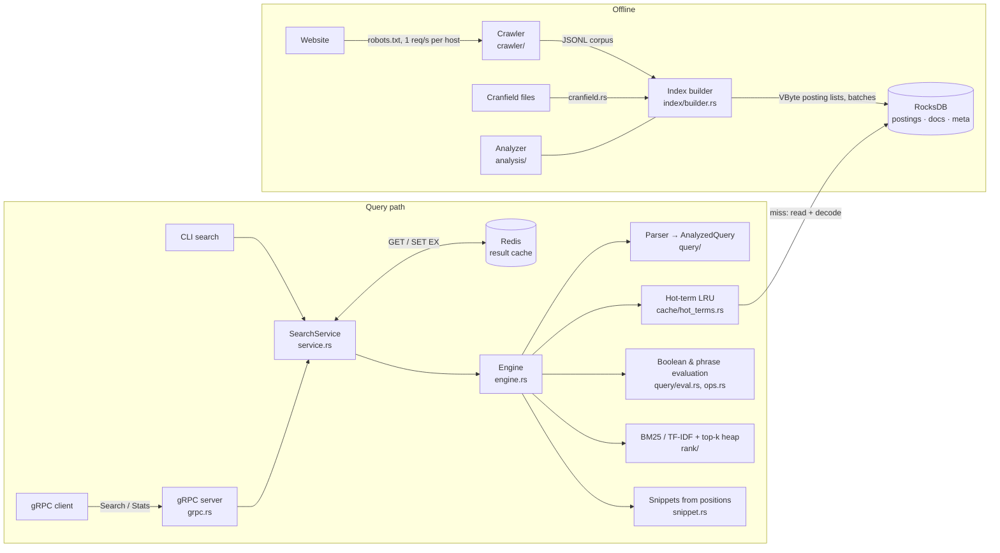

# Search Engine — Inverted Index & Ranking

A full-text search engine written in Rust from first principles. It crawls a
website politely, analyses the text (Unicode tokenisation, stop words,
stemming), builds a **compressed positional inverted index** stored in
**RocksDB**, and answers **boolean and phrase queries** ranked with **BM25 or
TF-IDF implemented from the formulas**. Decoded posting lists of hot terms stay
resident in memory, whole results are cached in **Redis**, and the engine is
served over **gRPC**. It ships with benchmarks against baselines and a
retrieval-quality evaluation on the labelled Cranfield collection.

```text
$ search-engine search --index data/rust-docs-index -k 3 'ownership "borrow checker" -unsafe'
6 matches in 0.49 ms (bm25, from index)

 1. [11.3308] Borrowing - Rust By Example
    https://doc.rust-lang.org/rust-by-example/scope/borrow.html
    **Borrowing** Most of the time, we’d like to access data without taking **ownership** over it. To accomplish this, Rust uses a **borrowing** mechanism. Instead of passing objects by value (T …
```

(first of three hits shown)

**New here? Read [docs/WALKTHROUGH.md](docs/WALKTHROUGH.md)** — a guided tour for
someone who knows basic data structures but not Rust or information retrieval.

## What is built from scratch, and what is not

| From scratch (this repository) | From a crate |
|---|---|
| Analysis pipeline: word splitting → lowercasing → stop words → stemming, with positions | Unicode word boundaries (`unicode-segmentation`), Porter2 stemmer (`rust-stemmers`) |
| VByte integer coding and delta-gap positional posting lists | Key-value storage (`rocksdb`) |
| In-memory index builder, column-family layout, index fingerprint | HTML parsing (`scraper`), robots.txt parsing (`texting_robots`) |
| BM25 and TF-IDF scoring, binary-heap top-k | LRU container behind the hot-term cache (`lru`) |
| Query lexer, recursive-descent parser, query analysis | HTTP client (`reqwest`), async runtime (`tokio`) |
| Posting-list intersection / union / difference, positional phrase matching | gRPC (`tonic`, `prost`), Redis client (`redis`) |
| Crawler: frontier, scope, URL normalisation, per-host throttle, redirect handling | CLI parsing (`clap`) |
| Hot-term cache policy, Redis cache keys and fallback, benchmarks, metrics | |

## Architecture



A query's life: **parse** (`AND`/`OR`/`NOT`/`-`/parentheses/phrases) →
**analyse** (same analyser as indexing) → **Redis lookup** keyed by
index version + ranker + k + normalised query → **evaluate** the boolean
structure with sorted posting-list merges and positional phrase checks →
**score** every match term-at-a-time → keep the **top k** in a min-heap →
load titles/URLs and build snippets → store in Redis.

## Quickstart

Requirements: a stable Rust toolchain; on Linux also `clang`/`libclang-dev`
(RocksDB's bindings are generated with bindgen). `protoc` is **not** needed — the
build uses a vendored copy. Redis is optional.

```sh
cargo build --release
alias se=./target/release/search-engine

# 1. Crawl (≈5 minutes at 1 request/second; robots.txt is honoured)
se crawl --seed https://doc.rust-lang.org/book/ --seed https://doc.rust-lang.org/rust-by-example/ \
   --exclude print.html --max-pages 300 --out data/rust-docs.jsonl

# 2. Index
se index --input data/rust-docs.jsonl --index data/rust-docs-index

# 3. Search
se search --index data/rust-docs-index '"interior mutability"'
se search --index data/rust-docs-index --ranker tfidf '(closure OR closures) iterator -async'
se search --index data/rust-docs-index --any how does the borrow checker work   # free text

# 4. Serve over gRPC (Redis optional; without it the result cache is simply off)
redis-server --daemonize yes
se serve --index data/rust-docs-index --addr 127.0.0.1:50051 --redis-url redis://127.0.0.1:6379
cargo run --release --example grpc_client -- 'ownership "borrow checker"'
```

Cranfield and evaluation:

```sh
./scripts/download_cranfield.sh           # into data/cranfield/, checksum-verified
se index --input data/cranfield/cran.all.1400 --format cranfield --index data/cranfield-index
se eval  --index data/cranfield-index --queries data/cranfield/cran.qry --qrels data/cranfield/cranqrel
```

With Docker (engine + Redis); the server reads its index from `./data/index`:

```sh
docker compose run --rm engine index --input /data/rust-docs.jsonl --index /data/index
docker compose up --build
```

Shortcuts for all of the above live in the [Makefile](Makefile) (`make check`,
`make crawl`, `make eval`, `make bench`, `make serve`, …).

## CLI

| Command | Purpose | Key options |
|---|---|---|
| `crawl` | Polite breadth-first crawl to JSONL | `--seed` (repeatable), `--max-pages 300`, `--delay-ms 1000`, `--concurrency 4`, `--exclude`, `--out` |
| `index` | Build an index | `--input`, `--format jsonl\|cranfield`, `--index`, `--codec vbyte\|fixed32` |
| `search` | Query an index | `--ranker bm25\|tfidf`, `-k`, `--any`, `--bm25-k1`, `--bm25-b`, `--hot-terms`, `--redis-url`, `--json` |
| `serve` | gRPC server; stops cleanly on Ctrl-C / SIGTERM | `--addr`, plus the engine and cache options of `search` |
| `bench` | Build time, index size, cold/warm latency vs baselines | see [BENCHMARKS.md](BENCHMARKS.md) |
| `eval` | Recall@10/100, MAP, nDCG@10 on Cranfield for both rankers | `--queries`, `--qrels`, `--depth 1000` |

`RUST_LOG=debug` turns on more logging; `REDIS_URL` can replace `--redis-url`.

### Query language

| Query | Meaning |
|---|---|
| `rust ownership` | both terms (implicit AND) |
| `rust AND ownership` | the same, explicitly |
| `borrow OR lifetime` | either term |
| `rust NOT unsafe`, `rust -unsafe` | `rust` but not `unsafe` |
| `"memory safety"` | exact phrase (stop words inside keep their place) |
| `(ownership OR borrow) -unsafe` | grouping; precedence is NOT > AND > OR |

Operators are upper case only, so `and`/`or`/`not` are ordinary (stop) words.
Every word goes through the same analyser as the documents, so `Foxes` matches
`fox`.

## gRPC API

[`proto/search.proto`](proto/search.proto), package `search.v1`, service `SearchApi`:

* `Search(SearchRequest{query, k, ranker, any_terms}) → SearchResponse{hits[], total_matches, cache_hit, took_micros}`
  where each hit is `{doc_id, external_id, title, url, score, snippet}`.
  A malformed query returns `INVALID_ARGUMENT`.
* `Stats() → {num_docs, num_terms, avg_doc_len, index_version, codec, hot-term cache stats, result-cache stats}`.

[`examples/grpc_client.rs`](examples/grpc_client.rs) is a complete client
(`SEARCH_ADDR` selects the server).

## Benchmarks

Measured on an Apple M5 Pro laptop (run 1 of 3; the other runs agree within a
few percent). Full methodology, commands, all three runs and caveats are in
[BENCHMARKS.md](BENCHMARKS.md).

| | Rust docs crawl (300 pages) | Cranfield (1,400 docs) |
|---|---:|---:|
| Index build, total (median of 3) | 0.058 s (5,185 docs/s) | 0.054 s (25,778 docs/s) |
| Posting lists, VByte vs fixed-width `u32` | 315,504 vs 971,256 bytes (3.08× smaller) | 405,063 vs 1,289,312 bytes (3.18× smaller) |
| Query p50, cold (fresh process) | 521.5 µs | 513.3 µs |
| Query p50, warm, hot-term cache on | 124.5 µs | 111.0 µs |
| Query p50, warm, Redis hit | 72.7 µs | 71.5 µs |
| Query p50, baseline linear scan | 46,135.7 µs | 39,614.8 µs |

Retrieval quality on Cranfield (225 queries):

| Ranker | Recall@10 | Recall@100 | MAP | nDCG@10 |
|---|---:|---:|---:|---:|
| BM25 | 0.4010 | 0.7510 | 0.3135 | 0.3729 |
| TF-IDF | 0.3971 | 0.7473 | 0.2946 | 0.3523 |

## Project layout

```text
src/
  main.rs                CLI (clap): crawl, index, search, serve, bench, eval
  analysis/              tokeniser, stop words, stemming, positions
  index/vbyte.rs         variable-byte integer coding
  index/postings.rs      positional posting lists, VByte and fixed-u32 codecs
  index/builder.rs       in-memory inversion
  index/store.rs         RocksDB column families, writer and read-only reader
  rank/                  BM25, TF-IDF, top-k heap
  query/                 lexer, recursive-descent parser, analysis, set ops, phrase matching
  engine.rs              query execution, scoring, snippets
  cache/hot_terms.rs     LRU of decoded posting lists
  cache/result_cache.rs  Redis result cache
  service.rs             engine + cache, used by the CLI, gRPC and benchmarks
  grpc.rs                tonic server, graceful shutdown
  crawler/               async crawler, robots.txt, throttle, URL normalisation, HTML extraction
  cranfield.rs, eval.rs  labelled test collection and metrics
  baseline.rs, bench.rs  linear-scan baseline and benchmark harness
proto/search.proto       gRPC contract (Rust code generated by build.rs)
tests/                   end-to-end, gRPC, Redis, crawler and baseline-agreement tests
bench/                   benchmark queries and recorded results
scripts/                 Cranfield download, crawl reproduction, machine info
docs/WALKTHROUGH.md      guided tour and interview notes
```

## Testing

```sh
cargo fmt --all -- --check
cargo clippy --all-targets -- -D warnings
cargo test                                   # Redis tests skip without REDIS_URL
REDIS_URL=redis://127.0.0.1:6379 cargo test  # what CI runs (Redis service container)
```

The suite includes property tests (VByte and posting round-trips, set
operations against `BTreeSet`, top-k against a full sort), hand-computed
BM25/TF-IDF scores, a crawler test against a local HTTP server, a gRPC test on an
ephemeral port, and a test that the linear-scan baseline and the index return
identical rankings.

## Limitations

Single node; the index is built in memory and rebuilt from scratch (no segments,
merges, updates or deletes); no skip lists or dynamic pruning (WAND/MaxScore);
phrases are scored as their individual terms. See
[docs/WALKTHROUGH.md](docs/WALKTHROUGH.md#limitations) for the full list and
what a production engine does instead.

## License

MIT — see [LICENSE](LICENSE).
