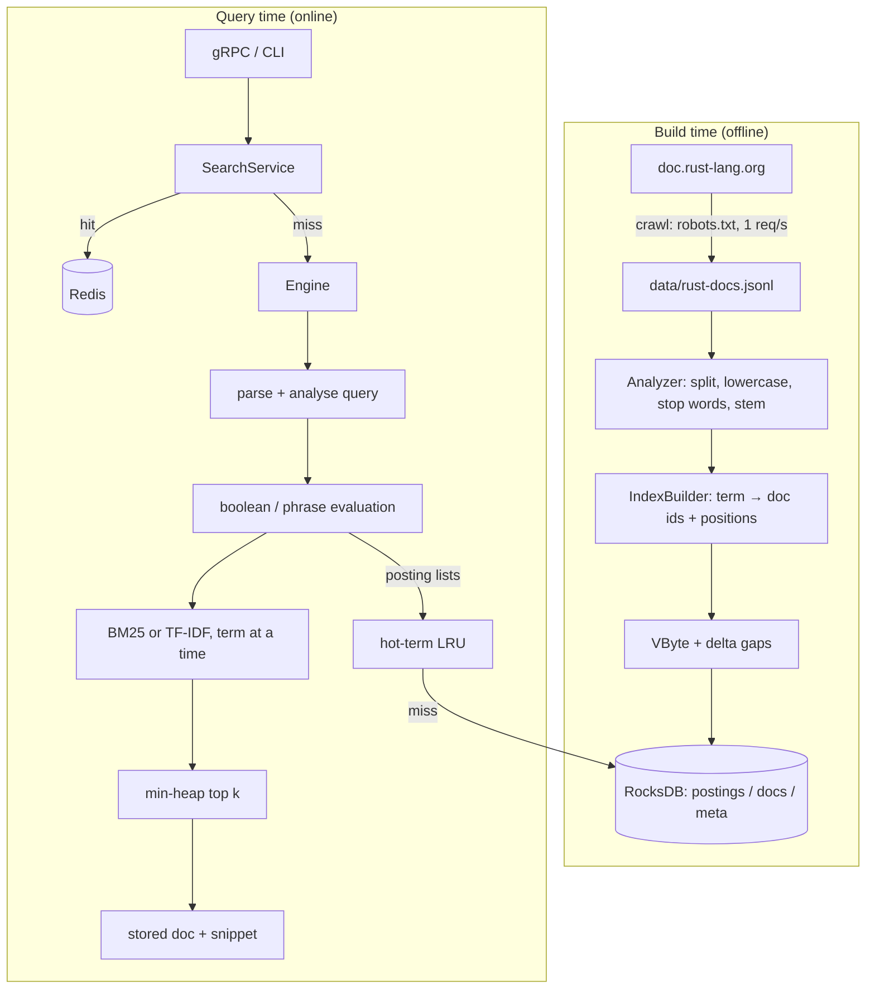

# Walkthrough

A guided tour of this search engine for someone who knows basic data structures
and algorithms but not Rust or information retrieval (IR). Read it top to
bottom once, then use the tables to jump into the code.

Contents

1. [Reading order](#1-reading-order)
2. [The whole system in one picture](#2-the-whole-system-in-one-picture)
3. [Each resume phrase → code](#3-each-resume-phrase--code)
4. [A query's life, step by step](#4-a-querys-life-step-by-step)
5. [Trade-offs](#5-trade-offs)
6. [Limitations](#limitations)
7. [Rust concepts used here](#7-rust-concepts-used-here)
8. [Likely interview questions](#8-likely-interview-questions)
9. [A 5-minute demo](#9-a-5-minute-demo)

---

## 1. Reading order

Each step only depends on the ones before it. The commit history follows the
same order, so `git log --reverse` is a second way to read the project.

| # | File | What you learn |
|---|---|---|
| 1 | `src/analysis/mod.rs`, `stopwords.rs` | How text becomes *terms* with *positions* |
| 2 | `src/index/vbyte.rs` | Variable-byte integer compression |
| 3 | `src/index/postings.rs` | Positional posting lists and their byte format |
| 4 | `src/index/builder.rs` | Building the inverted index in memory |
| 5 | `src/index/store.rs` | Persisting it in RocksDB |
| 6 | `src/rank/bm25.rs`, `tfidf.rs`, `topk.rs` | Scoring and picking the best k |
| 7 | `src/query/lexer.rs`, `parser.rs` | Parsing `rust -unsafe "memory safety"` |
| 8 | `src/query/analyzed.rs`, `ops.rs`, `eval.rs` | Turning the parse tree into matching documents |
| 9 | `src/engine.rs`, `snippet.rs` | Putting it together: one query end to end |
| 10 | `src/cache/hot_terms.rs`, `cache/result_cache.rs`, `service.rs` | The two caches |
| 11 | `proto/search.proto`, `build.rs`, `src/grpc.rs` | The network API |
| 12 | `src/crawler/` | Where the corpus comes from |
| 13 | `src/cranfield.rs`, `src/eval.rs` | Measuring quality |
| 14 | `src/baseline.rs`, `src/bench.rs` | Measuring speed and size |
| 15 | `src/main.rs` | The CLI that wires it all |

Tests live next to the code (`#[cfg(test)] mod tests` at the bottom of each
file) and in `tests/`. Reading a module's tests is often the fastest way to see
what it does.

---

## 2. The whole system in one picture



The key idea of an **inverted index**: instead of storing "document → words"
(which forces you to read every document for every query), store
"word → list of documents containing it". A query only touches the lists for its
own words.

---

## 3. Each resume phrase → code

| Resume phrase | Where | Main functions |
|---|---|---|
| full-text search engine over a **crawled corpus** | `src/crawler/mod.rs`, `politeness.rs`, `urls.rs`, `extract.rs`; `src/corpus.rs` | `crawl`, `fetch`, `fetch_robots`, `RobotsPolicy::from_response`, `HostThrottle::wait_turn`, `normalize`, `Scope::contains`, `extract` |
| **tokenization** | `src/analysis/mod.rs` | `Analyzer::analyze`, `Analyzer::analyze_document`, `Analyzer::analyze_into` |
| **stemming** | `src/analysis/mod.rs` (Porter2 via `rust-stemmers`) | `Analyzer::normalize_word` |
| **stop-word handling** | `src/analysis/stopwords.rs`, `src/analysis/mod.rs` | `ENGLISH`, `Analyzer::normalize_word` |
| **compressed inverted index** | `src/index/vbyte.rs`, `src/index/postings.rs` | `vbyte::encode_u32`, `vbyte::Reader::read_u32`, `postings::encode` / `decode` (`encode_vbyte`, `decode_vbyte`) |
| **with positional postings** | `src/index/builder.rs`, `src/index/postings.rs`, `src/index/store.rs` | `IndexBuilder::add`, `IndexBuilder::finish`, `Posting`, `PostingList`, `write_index`, `IndexReader::postings` |
| **BM25** ranking from scratch | `src/rank/bm25.rs`, `src/engine.rs` | `Bm25::idf`, `<Bm25 as Scorer>::score`, `Engine::score` |
| **TF-IDF** ranking from scratch | `src/rank/tfidf.rs` | `TfIdf::idf`, `TfIdf::weight`, `<TfIdf as Scorer>::score`, `document_norms` |
| (ranking) top-k | `src/rank/topk.rs` | `top_k` |
| **phrase** query parsing | `src/query/lexer.rs`, `src/query/analyzed.rs`, `src/query/ops.rs` | `tokenize` (quotes), `AnalyzedQuery::from_text`, `phrase_docs` |
| **boolean** query parsing | `src/query/parser.rs`, `src/query/eval.rs`, `src/query/ops.rs` | `parse`, `Parser::or_expr` / `and_expr` / `unary` / `primary`, `matching_docs`, `intersect`, `union`, `difference` |
| **Redis caching** | `src/cache/result_cache.rs`, `src/service.rs` | `ResultCache::connect`, `key`, `get`, `put`; `SearchService::search` |
| **in-memory index residency for hot terms** | `src/cache/hot_terms.rs`, `src/engine.rs` | `HotTermCache::get_or_load`, `Engine::load_postings` |
| **benchmarking cold vs warm query latency** | `src/bench.rs`, `src/main.rs` | `bench::run`, `cold_query_in_child`, `cold_query`, `measure_warm`, `summarize` |
| **index build time and index size** | `src/bench.rs`, `src/index/store.rs` | `measure_build`, `WriteReport`, `IndexReader::column_family_sizes`, `postings::fixed_u32_len` |
| **against a baseline** | `src/baseline.rs`, `src/index/postings.rs` | `LinearScan::search` (latency baseline); `Codec::FixedU32` (size/build baseline) |
| **measuring recall on a labelled query set** | `src/cranfield.rs`, `src/eval.rs` | `read_documents`, `read_queries`, `read_judgements`, `recall_at`, `average_precision`, `ndcg_at`, `evaluate_cranfield` |
| Stack: **Rust** | everything | `Cargo.toml` |
| Stack: **RocksDB** | `src/index/store.rs` | `write_index`, `IndexReader::open`, `column_family_options` |
| Stack: **gRPC** | `proto/search.proto`, `build.rs`, `src/grpc.rs`, `examples/grpc_client.rs` | `GrpcSearch::search`, `GrpcSearch::stats`, `serve`, `shutdown_signal` |
| Stack: **Docker** | `Dockerfile`, `docker-compose.yml`, `.github/workflows/ci.yml` (`docker` job) | — |

The rest of this section explains each phrase in plain English.

### 3.1 "full-text search engine over a crawled corpus"

The corpus is 300 pages of *The Rust Programming Language* and *Rust by
Example*, fetched by the project's own crawler (`search-engine crawl`).

How the crawler works (`src/crawler/mod.rs::crawl`):

1. **Frontier** — a queue (`VecDeque`) of URLs to visit, starting with the
   seeds. It is breadth-first: pages close to the seed are fetched first.
2. **De-duplication** — every URL is put into canonical form first
   (`urls::normalize`: drop `#fragment`, `dir/index.html` → `dir/`, sort query
   parameters, lower-case host), then checked against a `seen` set. Page *text*
   is also hashed, so two URLs serving identical content are stored once.
3. **Scope** — `Scope::contains` only allows URLs on the seed's host *and* under
   the seed's directory, so seeding `/book/` does not wander into `/std/`.
4. **robots.txt** — before the first request to a host, `fetch_robots` downloads
   `/robots.txt`; `RobotsPolicy::from_response` follows RFC 9309: a missing file
   (4xx) allows everything, an unreachable one (5xx / network error) disallows
   everything. Rule matching uses the `texting_robots` crate. A `Crawl-delay`
   longer than ours is respected.
5. **Politeness delay** — `HostThrottle::wait_turn` gives each request a time
   slot at least `--delay-ms` (default 1000 ms) after the previous slot for the
   same host. Up to `--concurrency` fetches run at once as tokio tasks, but
   they still queue behind the same host's slots, so one host never sees more
   than one request per second.
6. **Redirects** are not followed automatically; the `Location` target goes back
   into the frontier so it passes the same robots/scope/duplicate checks.
7. **Extraction** (`extract.rs::extract`) parses the HTML with `scraper`, takes
   the `<title>`, and collects visible text from `<main>` (falling back to
   `<article>`, `[role=main]`, `<body>`), skipping `script`, `style`, `nav`,
   `header`, `footer` and similar. Block elements become spaces so
   `<p>a</p><p>b</p>` reads "a b". Links come from the whole page.
8. Output is JSONL (`corpus.rs`): one `{"id","url","title","body"}` per line.

The real crawl: 300 pages in 302 s, 302 requests, 0 HTTP errors, robots.txt
fetched (status 200, no crawl-delay). `scripts/crawl_rust_docs.sh` reproduces it.

### 3.2 "tokenization, stemming, stop-word handling"

`Analyzer` (`src/analysis/mod.rs`) runs the *same* pipeline over documents at
index time and over queries at search time — otherwise "Foxes" in a query would
never meet "fox" in the index.

For each word:

1. **Tokenise** with Unicode word boundaries (UAX #29, `unicode_word_indices`):
   `naïve`, `don't` and `3.14` stay whole; `HashMap::new()` → `HashMap`, `new`.
2. **Lowercase**, and fold the curly apostrophe `’` into `'`.
3. **Stop words**: drop the 174 words of the Snowball English list ("the", "is",
   "of", …). They occur everywhere, so they cost space and carry no ranking
   signal. *Their position is still counted* (see the phrase section).
4. **Stem** with the Snowball English (Porter2) stemmer from `rust-stemmers`:
   `connection`, `connected`, `connecting` → `connect`; `foxes` → `fox`;
   `memory` → `memori`. Stemming is the one analysis step taken from a crate.

Words longer than 64 bytes are skipped as junk. A document is analysed as title
then body, with a gap of 100 positions in between (`FIELD_POSITION_GAP`) so a
phrase can never span the two fields.

Example — `analyze("The quick brown foxes")`:

| word | position | after lowercase | stop word? | term |
|---|---:|---|---|---|
| The | 0 | the | yes | — |
| quick | 1 | quick | no | `quick` |
| brown | 2 | brown | no | `brown` |
| foxes | 3 | foxes | no | `fox` |

### 3.3 "a compressed inverted index with positional postings"

**Inverted index.** `IndexBuilder::add` gives each document the next id
(0, 1, 2, …), analyses it, and appends one `Posting { doc_id, positions }` to the
list of every term it contains. Because ids only grow, every list comes out
sorted by doc id — which every algorithm later depends on.

**Positional.** A posting stores *where* the term occurs, not just *that* it
occurs. Positions make phrase queries possible and let snippets jump straight to
the match.

**Compressed.** `postings::encode_vbyte` writes, for each term:

```text
df  |  for each document: doc_gap, tf, position_gap × tf
```

* `df` — how many documents contain the term;
* `doc_gap` — this doc id minus the previous one (the first is the id itself);
* `tf` — how many times the term occurs in this document;
* `position_gap` — this position minus the previous one in the same document.

Gaps are small numbers, and **VByte** (`vbyte::encode_u32`) stores small numbers
in fewer bytes: 7 bits of payload per byte, low bits first, the top bit meaning
"another byte follows".

```text
5   = 0000101                 → 0000_0101                  (1 byte)
130 = 0000001 0000010         → 1000_0010 0000_0001        (2 bytes)
```

**Worked example 1 — "The quick brown foxes".** Index it as the title of
document 0 (test: `builder.rs::walkthrough_sentence_becomes_the_documented_bytes`).
The terms are `brown`, `fox`, `quick`; `fox` has one posting, doc 0 at
position 3:

| field | value | VByte byte |
|---|---:|---|
| df | 1 | `01` |
| doc gap | 0 − 0 = 0 | `00` |
| tf | 1 | `01` |
| position gap | 3 − 0 = 3 | `03` |

`fox` → `01 00 01 03`: **4 bytes**. As fixed-width `u32`s (the baseline codec)
the same four numbers take **16 bytes**: `01 00 00 00 00 00 00 00 01 00 00 00 03 00 00 00`.

**Worked example 2 — gaps across documents.** Suppose `fox` occurs in doc 3 at
position 3, doc 7 at positions 1 and 5, and doc 300 at position 2 (test:
`postings.rs::vbyte_encodes_the_documented_example`):

```text
df=3 | gap 3, tf 1, pos 3 | gap 4, tf 2, pos 1, +4 | gap 293, tf 1, pos 2
03   | 03     01    03    | 04     02    01     04 | A5 02    01    02     = 12 bytes
```

293 does not fit in 7 bits: 293 = 2·128 + 37, so the first byte is 37 (`0x25`)
with the continuation bit set (`0xA5`), and the second byte is 2 (`0x02`). The
fixed-width baseline needs 11 numbers × 4 = **44 bytes**.

On the real corpora this gives posting lists **3.08× (Rust docs) and 3.18×
(Cranfield) smaller** than fixed-width `u32`s (see `BENCHMARKS.md`).

**Storage** (`src/index/store.rs::write_index`). RocksDB is an embedded
key-value store (an LSM tree). The index uses three *column families* —
separate key spaces with their own settings:

| column family | key | value |
|---|---|---|
| `postings` | the term's UTF-8 bytes | VByte posting list |
| `docs` | doc id as big-endian `u32` (so byte order = numeric order) | JSON `{id, url, title, body}` |
| `meta` | `stats`, `doc_lengths`, `doc_norms` | collection statistics, every document's length (VByte), TF-IDF norms (`f64`) |

The whole index is built in memory, then written in batches of 10,000 keys with
the write-ahead log off (if the build fails we rebuild from the corpus anyway),
then flushed and compacted. RocksDB's own compression is off so measured sizes
show *our* encoding; the `postings` family has a Bloom filter so lookups of
words that are not in the index rarely touch disk. `stats` includes an
`index_version`: an FNV-1a hash of every posting list and stored document, used
to namespace cached results. Readers open the database read-only, so several
processes can share one index.

A real engine does not build everything in RAM: it writes sorted **segments** as
memory fills up and **merges** them in the background (Lucene, Tantivy). That is
future work here (see [Limitations](#limitations)).

### 3.4 "BM25 and TF-IDF ranking from scratch"

A query's score for a document is the sum, over the query's (positive) terms, of
a per-term score. Both rankers implement the `Scorer` trait
(`src/rank/mod.rs`); `Engine::score` is generic over it.

**TF-IDF** (`src/rank/tfidf.rs`) — "a word matters if it is frequent here
(tf) but rare overall (idf)":

```text
idf(t)  = ln(N / df)
w(t, d) = (1 + ln tf) · idf(t)            log damps repeated words
|d|     = sqrt(Σ over all terms of d of w(t, d)²)
score   = Σ over query terms of (1 + ln qtf) · idf(t) · w(t, d) / |d|
```

Dividing by `|d|` (the document vector's length) is cosine normalisation: long
documents do not win just by containing more words. `|d|` needs *every* term of
the document, so `document_norms` computes it once at index time and the
`meta` column family stores it.

**BM25** (`src/rank/bm25.rs`) — the standard modern ranking function:

```text
idf(t)  = ln(1 + (N − df + 0.5) / (df + 0.5))
score   = Σ qtf · idf(t) · tf · (k1 + 1) / (tf + k1 · (1 − b + b · dl / avgdl))
```

* **Saturation (`k1 = 1.2`)**: the score grows with tf but levels off at
  `idf · (k1 + 1)` — the 10th "rust" adds far less than the 1st. TF-IDF's
  `1 + ln tf` also grows slowly, but never stops growing.
* **Length normalisation (`b = 0.75`)**: `dl / avgdl` compares the document's
  length to the average; long documents need more occurrences for the same
  score. `b = 0` turns this off, `b = 1` applies it fully.
* The `1 +` inside the log (as in Lucene) keeps idf positive even for words in
  more than half of the documents.

Both `k1` and `b` are configurable (`--bm25-k1`, `--bm25-b`), and the choice of
ranker is per query (`--ranker`, or the `ranker` field in gRPC).

**Worked example (test: `bm25.rs::scores_match_hand_computed_example` and
`tests/end_to_end.rs::bm25_ranking_matches_the_hand_computed_example`).**

| doc | text | terms after analysis | length |
|---|---|---|---:|
| D0 | rust is fast | rust, fast | 2 |
| D1 | rust rust borrow check | rust ×2, borrow, check | 4 |
| D2 | safe code is fast code | safe, code ×2, fast | 4 |

N = 3, avgdl = 10 / 3 = 3.3333. Query: **rust fast**. Both terms have df = 2, so

idf = ln(1 + (3 − 2 + 0.5) / (2 + 0.5)) = ln(1.6) = **0.4700**

| doc | term | tf | 1 − b + b·dl/avgdl | tf·(k1+1) / (tf + k1·that) | × idf |
|---|---|---:|---:|---:|---:|
| D0 | rust | 1 | 0.25 + 0.75·0.6 = 0.70 | 2.2 / 1.84 = 1.1957 | 0.5620 |
| D0 | fast | 1 | 0.70 | 1.1957 | 0.5620 |
| D1 | rust | 2 | 0.25 + 0.75·1.2 = 1.15 | 4.4 / 3.38 = 1.3018 | 0.6118 |
| D2 | fast | 1 | 1.15 | 2.2 / 2.38 = 0.9244 | 0.4345 |

Totals: **D0 = 1.1239**, **D1 = 0.6118**, **D2 = 0.4345** (the engine computes
1.123922, 0.611839, 0.434457). D0 wins because it has both words; D1 beats D2
because "rust" appears twice there — but the second occurrence adds only
0.6118 − 0.4345 = 0.1773 over a single one, which is saturation at work.

TF-IDF on the same corpus gives D0 = 0.5734, D1 = 0.1639, D2 = 0.0748 (same
order; test: `tfidf.rs::scores_match_hand_computed_example`).

**Top-k** (`src/rank/topk.rs::top_k`). We want the best k of n scored documents.
Sorting is O(n log n). Instead keep a **min-heap of size k**: the root is the
worst of the current best k; each new document only has to beat the root to
replace it. O(n log k) time, O(k) memory. Rust's `BinaryHeap` is a max-heap, so
entries are wrapped in `Reverse`. Ties go to the lower doc id, so results are
deterministic.

### 3.5 "phrase and boolean query parsing"

**Lexer** (`src/query/lexer.rs::tokenize`) turns the string into tokens:
words, `"phrases"`, `AND`, `OR`, `NOT`, `-`, `(`, `)`. Operators must be upper
case; a `-` only negates at the start of a word (`-unsafe`), so
`state-of-the-art` stays one word.

**Parser** (`src/query/parser.rs`) — recursive descent: one function per grammar
rule, lowest precedence first.

```text
or_expr  := and_expr ( "OR" and_expr )*
and_expr := unary ( "AND"? unary )*        two operands side by side = AND
unary    := ( "NOT" | "-" ) unary | primary
primary  := WORD | PHRASE | "(" or_expr ")"
```

Because `or_expr` calls `and_expr`, which calls `unary`, the deeper rule binds
tighter: `a OR b c` parses as `a OR (b AND c)` and `NOT a b` as `(NOT a) AND b`.
Errors (`(a OR b`, `a OR`, `AND a`) come back as a `ParseError`, which the gRPC
layer turns into `INVALID_ARGUMENT`.

**Analysis of the query** (`src/query/analyzed.rs::AnalyzedQuery::analyze`) runs
every word through the `Analyzer`: stop words disappear from their AND/OR, a word
that splits into several terms becomes a phrase (`state-of-the-art` →
`"state@0 art@3"`), and a phrase keeps each term's offset from the first one.

**Boolean evaluation** (`src/query/eval.rs::matching_docs`) on sorted doc-id lists
(`src/query/ops.rs`):

* `a AND b` → `intersect`: walk both lists with two pointers, O(|a| + |b|). If one
  list is more than 16× shorter, binary-search its ids in the long list instead,
  O(s log l).
* `a OR b` → `union`: the merge step of merge sort.
* `a AND NOT b` / `a -b` → `difference`: everything in `a` that is not in `b`.
* An AND intersects the positive operands shortest-first (small intermediate
  results), then subtracts the negated ones. A pure negation (`-unsafe` alone)
  is taken against all doc ids.

**Phrases** (`ops.rs::phrase_docs`) — *positional intersection*:

1. intersect the doc ids of all the phrase's terms;
2. in each shared document, for every position p of the first term, check that
   term i occurs at p + offsetᵢ (binary search in its sorted positions).

Stop words are removed but their positions counted, so `"wing in a slipstream"`
becomes `wing@0 slipstream@3` and still requires exactly two words in between.

### 3.6 "Redis caching"

`ResultCache` (`src/cache/result_cache.rs`) stores *whole results* (hits with
titles, URLs, scores and snippets) as JSON with a TTL (default 300 s).

The key is `namespace:index_version:ranker(params):k:canonical_query`, for example
(a real key from the Rust-docs index):

```text
walkthrough:de7756fafe0bd41e:bm25(k1=1.2,b=0.75):3:and("memori@0 safeti@1",not(unsaf),rust)
```

* **index_version** changes whenever the index changes, so stale results are
  never served; old keys just expire.
* **ranker with parameters** — BM25 with different k1/b is a different result.
* **canonical query** is the *analysed* query with AND/OR operands sorted, so
  `rust -unsafe "memory safety"` and `"Memory Safety" AND -unsafe Rust` share one
  entry (verified: the second ran as a cache hit).

**Redis is optional.** `ResultCache::connect` returns `None` and logs a warning
if Redis is unreachable at startup; the engine then simply runs without a result
cache. After startup, every Redis error (or a reply slower than 250 ms) is logged
and treated as a miss, so a sick Redis can never make a query fail. Logs are
throttled to the 1st, 2nd, 4th, 8th… failure. Values are written with
`SET key value EX ttl` after a miss (`SearchService::search`).

### 3.7 "in-memory index residency for hot terms"

Without a cache, every query term means: RocksDB lookup → copy the blob → VByte
decode into a `PostingList`. Query traffic is skewed — some words appear in many
queries — so `HotTermCache` (`src/cache/hot_terms.rs`) keeps **decoded** posting
lists of recently used terms in memory, as `Arc<PostingList>` in an LRU
(least-recently-used) map with a capacity counted in terms (default 10,000,
`--hot-terms`). The LRU container is the `lru` crate; the policy around it is
ours:

* the mutex is **not** held while loading from RocksDB, so one slow read does not
  block other queries (two threads may occasionally load the same term; the
  second insert just replaces the first);
* terms that are not in the index, and errors, are not cached;
* hit/miss counters and an approximate byte size are exposed through `Stats`.

Measured effect (BENCHMARKS.md, run 1): warm p50 drops from 134.1 µs to 124.5 µs
on the Rust docs and from 144.3 µs to 111.0 µs on Cranfield, whose long queries
touch more terms.

### 3.8 "benchmarking cold vs warm query latency, index build time and index size against a baseline"

`search-engine bench` (`src/bench.rs::run`) measures, for one corpus:

* **build time** — `measure_build` builds the index 3 times per codec and reports
  the median (analysis + inversion, and the RocksDB write separately);
* **index size** — encoded posting bytes, each column family's SST size, and the
  whole directory; the **baseline** is a second, real index built with
  fixed-width `u32` postings (`--codec fixed32`);
* **cold latency** — `cold_query_in_child` spawns a **fresh process** per query
  (`search-engine bench-cold-query`): new RocksDB instance (empty block cache),
  empty hot-term cache, never-used Redis namespace;
* **warm latency** — `measure_warm`: one untimed pass, then timed rounds, with the
  hot-term cache off, on, and with Redis hits;
* **latency baseline** — `LinearScan::search` (`src/baseline.rs`): no index;
  re-analyse every document per query, check the boolean/phrase structure and
  score with the same BM25 code. It must return the same top-k as the index
  (39/39 and 225/225 queries did), and `tests/baseline_agrees.rs` uses it as an
  independent oracle.

Percentiles are nearest-rank over raw samples (`summarize`). The honest caveat:
the OS page cache cannot be dropped without root, so "cold" means cold
*application* caches.

### 3.9 "measuring recall on a labelled query set"

The **Cranfield collection** (`scripts/download_cranfield.sh`) has 1,400
aerodynamics abstracts, 225 queries and human judgements of which documents
answer which query, graded 1 (complete answer) to 4 (minimum interest).
`src/cranfield.rs` parses the three files. Two quirks are handled and
documented in the code: queries are renumbered by position (the judgement file
does that), and each query's single `-1` row is ignored.

`src/eval.rs::evaluate_cranfield` runs every query as free text (OR of its
words, top 1000) and averages:

* **Recall@k** = relevant documents found in the top k ÷ all relevant documents.
* **AP** = mean of precision@r over the ranks r where a relevant document
  appears (unfound ones count as 0). **MAP** averages AP over queries; it rewards
  putting relevant documents early.
* **nDCG@10** = Σ gain / log2(rank + 1) over the top 10, divided by the best
  possible value. Gains are graded: grade 1 → 4, …, grade 4 → 1.

Results: BM25 Recall@10 0.4010, Recall@100 0.7510, MAP 0.3135, nDCG@10 0.3729;
TF-IDF 0.3971, 0.7473, 0.2946, 0.3523. No parameter was tuned on these queries.

### 3.10 "Stack: Rust, RocksDB, gRPC, Docker"

* **gRPC** — `proto/search.proto` defines `SearchApi` with `Search` and `Stats`.
  `build.rs` generates Rust types and a server trait from it at compile time
  (`tonic-prost-build`, with a vendored `protoc`). `src/grpc.rs` implements the
  trait (`GrpcSearch`) by calling `SearchService`, validates `k` (0 → 10, capped
  at 1000) and the ranker, and maps bad queries to `INVALID_ARGUMENT`. `serve`
  stops accepting connections when `shutdown_signal` sees Ctrl-C or SIGTERM and
  lets in-flight requests finish (`tests/grpc.rs` checks this).
* **Docker** — multi-stage `Dockerfile`: compile in `rust:1.99-trixie`, copy only
  the binary into `debian:trixie-slim`, run as a non-root user. `docker-compose.yml`
  runs the engine with Redis. CI builds the image and runs `--version` in it.

---

## 4. A query's life, step by step

Query: `rust -unsafe "memory safety"`, k = 3, BM25, over the Rust-docs index.

1. **Transport.** `GrpcSearch::search` (or the CLI) receives the text and calls
   `SearchService::search`.
2. **Parse.** `parse` → `AND(rust, NOT(unsafe), "memory safety")`.
3. **Analyse.** `AnalyzedQuery::analyze` → `rust`, `not(unsaf)`, phrase
   `memori@0 safeti@1`. Canonical form:
   `and("memori@0 safeti@1",not(unsaf),rust)`.
4. **Result cache.** Build the key with the index version and look it up in
   Redis. On a hit, return immediately (a repeat of this query reported
   0.15 ms inside `SearchService::search`: analysis, the Redis GET and decoding
   the cached JSON).
5. **Off the async thread.** On a miss, `tokio::task::spawn_blocking` runs the
   engine, because RocksDB reads and scoring block the thread.
6. **Fetch postings.** For each term, `QueryPostings::postings` asks the hot-term
   cache, which on a miss reads RocksDB and VByte-decodes. A per-query memo makes
   sure each term is fetched once even though it is used for matching, scoring
   and snippets.
7. **Match.** `matching_docs`: phrase docs for `memori safeti` (positional
   intersection) ∩ docs with `rust`, minus docs with `unsaf` → **7 documents**.
8. **Score.** `Engine::score` walks each scoring term's posting list (`rust`,
   `memori`, `safeti` — never the negated `unsaf`) alongside the sorted candidate
   list and adds that term's BM25 score into an array aligned with the candidates.
9. **Top-k.** `top_k` keeps the best 3 in a min-heap.
10. **Hits.** For each, read the stored document from the `docs` column family and
    build a snippet: the first body position of any query term comes straight
    from the postings, so `make_snippet` only segments text up to that word and
    stems the ~30 words it shows.
11. **Cache fill.** `SET key json EX 300`, then return. Real output:

```text
 1. [7.7238] Understanding Ownership - The Rust Programming Language
    https://doc.rust-lang.org/book/ch04-00-understanding-ownership.html
    Understanding Ownership Ownership is **Rust’s** most unique feature and has deep implications for the rest of the language. It enables **Rust** to make **memory** **safety** guarantees without needing a garbage …
```

---

## 5. Trade-offs

**VByte vs PForDelta (and friends).** VByte decodes one integer at a time with a
branch per byte: simple, byte-aligned, decent compression (3.1–3.2× here).
PForDelta / FastPFor pack blocks of 128 gaps at the bit width that fits most of
them, storing outliers ("exceptions") separately; they compress better and
decode with SIMD at billions of integers per second, at the cost of complexity
and block-granular access. Elias–Fano gives near-optimal space with fast random
access; Lucene uses block-packed formats. For a corpus this size VByte decoding
is not the bottleneck — turning the hot-term cache off, which adds the RocksDB
read and decode back to every term, raises warm p50 by 7.7% (Rust docs) and 30.0% (Cranfield) — so
simplicity won.

**BM25 vs TF-IDF.** TF-IDF with cosine normalisation is the classic vector-space
model; its tf weight keeps growing and its length normalisation needs a norm over
every term of the document. BM25 comes from a probabilistic model, saturates tf,
normalises length relative to the average with a tunable strength, and needs only
the document length. On Cranfield BM25 was better on all four metrics (MAP 0.3135
vs 0.2946). Learned rankers (and neural re-rankers) beat both but need training
data.

**RocksDB vs custom segment files.** RocksDB gives crash-safe, sorted key-value
storage, block cache, Bloom filters and compaction for free, and point lookups by
term are exactly our access pattern. The cost is overhead per lookup (an LSM read
path) and less control over layout. Lucene/Tantivy instead write immutable
segment files with a term dictionary (FST), postings in blocks with skip data,
and memory-map them — better for very large indexes and scans, but far more code.

**Term-at-a-time vs document-at-a-time.** We score one term's whole posting list
at a time into an accumulator array (simple, cache-friendly for small candidate
sets). Document-at-a-time walks all lists in parallel by doc id, which enables
early termination with WAND / MaxScore / Block-Max WAND — skipping documents that
cannot enter the top k. That matters at scale; we score every match.

**Interleaved vs separate positions.** Positions are stored next to each doc's
tf, so every decode also decodes positions even for non-phrase queries. Lucene
keeps positions in a separate file so ranking-only queries skip them.

**Exact cache keys vs semantic caching.** The Redis key is the canonical
*analysed* query, so spelling, case, stemming and operand order do not split
entries, but `rust fast` and `fast rust OR rust fast` still differ. Results are
cached per k, so k = 10 and k = 20 are separate entries.

**LRU vs LFU for hot terms.** LRU is simple and adapts quickly; a burst of rare
terms can evict genuinely hot ones. LFU or TinyLFU (as in Caffeine) resists
that. A capacity in *terms* is also crude; a byte budget would be fairer to long
lists (the cache reports an approximate byte size).

**Stemming.** Porter2 raises recall (`connected` finds `connection`) but can
conflate unrelated words (`universe` / `university` → `univers`) and hurt
precision. Lemmatisation is more accurate but slower and language-specific.

---

## Limitations

What this engine does **not** do, and what a production engine does instead:

* **Index construction is all in memory.** No segments, no background merging;
  the corpus must fit in RAM during the build. *Real engines flush segments and
  merge them (log-structured merge).*
* **No incremental updates or deletes.** Changing one document means rebuilding.
  *Real engines add new segments and mark deletions in a bitmap until the next
  merge.*
* **No skip lists or dynamic pruning.** Every matching document is scored.
  *Skip pointers and WAND/MaxScore/Block-Max WAND avoid that.*
* **Positions are always decoded**, even for queries without phrases.
* **Phrases are scored as their individual terms**; a phrase match gets no extra
  boost beyond matching the filter, and there is no proximity scoring.
* **Snippets** start at the first body occurrence of *any* scoring term, which may
  not be where the phrase matched.
* **Single node, single index.** No sharding or replication; the gRPC API has no
  authentication or TLS.
* **English only.** One stop list, one stemmer; no synonyms, spelling correction or
  query suggestions.
* **Crawler**: frontier and `seen` set live in memory (no resume after a crash),
  no sitemap use, no JavaScript rendering, scope is fixed to the seeds' host and
  directory, redirects to other hosts are dropped by the scope check.
* **Result cache** keys contain the full canonical query (long queries make long
  keys) and entries are not shared across different k.
* **Evaluation** uses one small, old test collection (Cranfield); benchmarks use
  ~1.5 MB corpora that fit in memory, single-threaded, one query at a time.

---

## 7. Rust concepts used here

**Ownership and borrowing.** Every value has one owner; others *borrow* it with
`&` (shared) or `&mut` (exclusive), checked at compile time.
`IndexBuilder::add(&mut self, document: Document)` *takes ownership* of the
document (it is stored in the index), while `IndexBuilder<'a>` holds an
`&'a Analyzer` — a borrow that the lifetime `'a` proves cannot outlive the
analyser. `PhrasePart<'a>` borrows posting lists for the duration of one phrase
check without copying them.

**`Result` and `?`.** Fallible functions return `Result<T, E>`; `?` returns the
error early. Library errors are enums built with `thiserror` (`StoreError`,
`SearchError`, `CrawlError`), the binary uses `anyhow` for context-rich messages
(`.with_context(|| format!("opening index {}", …))`). There is no `unwrap()`
outside tests; a poisoned mutex is recovered explicitly
(`unwrap_or_else(PoisonError::into_inner)`).

**Enums and pattern matching.** The query trees (`Query`, `AnalyzedQuery`) are
enums; `Not(Box<Query>)` needs a `Box` because a type cannot contain itself
directly. Every evaluator is one `match` per node type, and the compiler checks
that every variant is handled.

**Traits and generics.** `Scorer` is implemented by `Bm25` and `TfIdf`;
`Engine::score<S: Scorer>` is generic, so the compiler generates one specialised
copy per ranker (*static dispatch*, no virtual call per posting).
`PostingSource` has an associated `Error` type, so the same `matching_docs`
works over RocksDB (`StoreError`) and over an in-memory index (`Infallible`).

**Smart pointers and shared state.** `Arc<PostingList>` lets the cache and many
queries share one decoded list. `Mutex` guards the LRU, atomics count hits and
misses without locking, and `RefCell` (in `QueryPostings`) allows a per-query
memo to be filled through a shared reference — *interior mutability* checked at
run time.

**Async with tokio.** The crawler, Redis client and gRPC server are `async`:
`await` yields the thread while waiting for the network. The crawler runs fetches
as tasks in a `JoinSet`; `tokio::select!` waits for Ctrl-C *or* SIGTERM;
`spawn_blocking` moves RocksDB work off the async worker threads. Tests use
`#[tokio::test(start_paused = true)]` to test the politeness delay with a virtual
clock.

**Code generation.** `build.rs` runs before compilation and turns the `.proto`
file into Rust; `#[derive(Serialize, Deserialize)]` and clap's
`#[derive(Parser)]` are macros that write code from type definitions.

**Modern syntax you will see.** `let … else` (`let Some(x) = … else { return … };`),
`if let … && condition` chains (Rust 2024), `impl Trait` in argument and return
position, iterator chains (`.iter().map().filter().collect()`).

---

## 8. Likely interview questions

**1. What is an inverted index and why use one?**
A map from each term to the sorted list of documents (and positions) containing
it. A query reads only its terms' lists instead of every document: here a warm
query takes ~0.1 ms versus ~40–46 ms for scanning the 1.5 MB corpus.

**2. What is in a posting, and why store positions?**
Doc id, term frequency and the word positions. Positions enable phrase queries and
let snippets jump to the match; the cost is bigger lists (152,294 positions vs
42,696 postings on the Rust docs).

**3. Why delta-encode before VByte?**
Sorted ids and positions have small gaps; VByte stores small numbers in one byte.
Absolute doc ids in a large index would need 3–4 bytes each.

**4. How does VByte work, and what is better?**
7 data bits per byte plus a continuation bit. Faster/denser: PForDelta, Simple-8b,
SIMD-BP128 (block bit-packing), Elias–Fano. VByte is byte-aligned and simple; I
measured 3.08–3.18× smaller postings than fixed `u32`.

**5. Explain BM25's k1 and b.**
k1 controls tf saturation (repeats add less and less, bounded by idf·(k1+1)); b
controls how strongly document length relative to the average is penalised
(0 = not at all, 1 = fully). Defaults 1.2 and 0.75.

**6. BM25 vs TF-IDF — which won and why?**
BM25 on all four Cranfield metrics (MAP 0.3135 vs 0.2946). Saturation stops a
document winning by repeating a word, and its length normalisation is relative and
tunable.

**7. How do you intersect two posting lists? Complexity?**
Two-pointer merge, O(m + n). If one list is much shorter, binary-search (or gallop)
its ids in the long one: O(m log n). Production engines add skip pointers. For
many lists, intersect shortest first.

**8. How do phrase queries work?**
Intersect doc ids, then check positions line up: term i at position p + offsetᵢ.
Stop words are removed but counted, so offsets stay exact.

**9. How does your parser handle precedence?**
Recursive descent with one function per level: OR → AND → NOT → primary. Lower
levels bind tighter, so `a OR b c` = `a OR (b AND c)`. Juxtaposition is AND.

**10. How do you evaluate NOT, including a query that is only `-x`?**
`a -x` = difference of sorted lists. A pure negation is taken against all doc
ids (the universe 0..N), which is O(N) and therefore expensive on big indexes.

**11. How do you get the top k efficiently?**
Bounded min-heap of size k: O(n log k) time, O(k) memory, versus O(n log n) to sort.

**12. How do you invalidate the Redis cache?**
Keys include an index-version fingerprint, the ranker and its parameters, k and the
canonical analysed query. Rebuilding the index changes the version, so old entries
are never read and expire by TTL — no explicit invalidation needed.

**13. What happens if Redis goes down?**
At startup: the cache is disabled with a warning. At runtime: errors and
replies slower than 250 ms are treated as misses and logged (throttled); queries
are answered from the index. Tested with an unreachable Redis.

**14. What does the hot-term cache store, and why not cache everything?**
Decoded posting lists of recently used terms, LRU-evicted, shared via `Arc`.
Memory: the decoded form is much larger than the VByte bytes (Cranfield: 684 terms
≈ 2.29 MB decoded). Caching only hot terms keeps memory bounded.

**15. Why RocksDB? What are column families?**
Embedded, crash-safe, sorted KV store with block cache and Bloom filters; point
lookups by term fit it well. Column families are separate key spaces with their
own options (only `postings` has a Bloom filter).

**16. How would you scale this to 100 million documents?**
Segment-based indexing with background merges; shard documents across nodes
(scatter-gather, merge top-k); replicate shards; skip lists and Block-Max WAND
for pruning; block-compressed postings; a term dictionary in memory (FST); keep
the result cache in front.

**17. How would you support updates and deletes?**
Write new documents to a new segment, mark deleted doc ids in a bitmap that query
evaluation subtracts, and purge them when segments merge.

**18. How is the crawler polite?**
robots.txt per RFC 9309 (including Crawl-delay), at least 1 s between requests to
a host even with concurrent workers, a descriptive User-Agent, a page cap and a
scope limit. The real crawl made 302 requests in 302 s.

**19. How did you measure cold vs warm, and what is the catch?**
Cold = fresh process per query (new RocksDB, empty caches, fresh Redis namespace).
Warm = repeated queries in one process. The catch: the OS page cache cannot be
dropped without root, so file reads may still be cached by the OS.

**20. Recall vs MAP vs nDCG?**
Recall ignores order; MAP rewards relevant documents near the top; nDCG also
uses graded relevance and a log discount. Report several because they disagree
about what "good" means.

**21. Why `spawn_blocking` in an async gRPC handler?**
RocksDB reads and scoring are blocking CPU/IO work. Running them on tokio's async
worker threads would stall every other request on that thread.

**22. How do you know your ranking code is correct?**
Unit tests pinned to hand-computed BM25/TF-IDF values, property tests for codecs
and set operations, and an independent linear-scan implementation that must
return identical rankings (225/225 Cranfield queries).

**23. Term-at-a-time or document-at-a-time?**
Term-at-a-time with an accumulator per candidate. Document-at-a-time enables
early termination (WAND), which is how large engines avoid scoring everything.

**24. Why must queries use the same analyser as documents?**
Otherwise query terms and index terms never match (`Foxes` vs `fox`). It is also
why changing the analyser requires a full re-index.

---

## 9. A 5-minute demo

Prepare once: `make build`, crawl or copy `data/rust-docs.jsonl`, run
`./scripts/download_cranfield.sh`, and start Redis (`redis-server --daemonize yes`).

**Minute 0–1: what it is.** Show the README diagram. "Crawler → analyser →
compressed positional inverted index in RocksDB → boolean/phrase queries → BM25 or
TF-IDF → Redis + gRPC."

**Minute 1–2: build the index.**

```sh
./target/release/search-engine index --input data/rust-docs.jsonl --index data/rust-docs-index
```

Point at the output: 300 documents, 5,128 terms, postings 315,504 bytes VByte vs
971,256 as fixed `u32` — "3× smaller just from gap + variable-byte encoding."

**Minute 2–3: query language.**

```sh
se=./target/release/search-engine
$se search --index data/rust-docs-index -k 3 'rust -unsafe "memory safety"'
$se search --index data/rust-docs-index -k 3 --ranker tfidf '(closure OR closures) iterator'
$se search --index data/rust-docs-index -k 3 --any how does the borrow checker work
```

Show the bold snippet terms ("matches are found from positions in the index") and
that `Rust’s` was matched by `rust` (analysis).

**Minute 3–4: serving and caching.**

```sh
$se serve --index data/rust-docs-index --redis-url redis://127.0.0.1:6379 &
cargo run --release --example grpc_client -- 'ownership "borrow checker"'   # cache hit: false
cargo run --release --example grpc_client -- 'ownership "borrow checker"'   # cache hit: true
kill %1                                                                     # "shut down cleanly"
```

Mention: if Redis is down the server logs a warning and keeps serving.

**Minute 4–5: numbers.**

```sh
$se eval --index data/cranfield-index --queries data/cranfield/cran.qry --qrels data/cranfield/cranqrel
```

BM25 MAP 0.3135 vs TF-IDF 0.2946. Then open BENCHMARKS.md: warm p50 ≈ 0.11–0.12 ms,
cold ≈ 0.5 ms, Redis hit ≈ 0.07 ms, linear scan ≈ 40–46 ms with identical results.
Close with the limitations list — knowing them is part of the answer.
